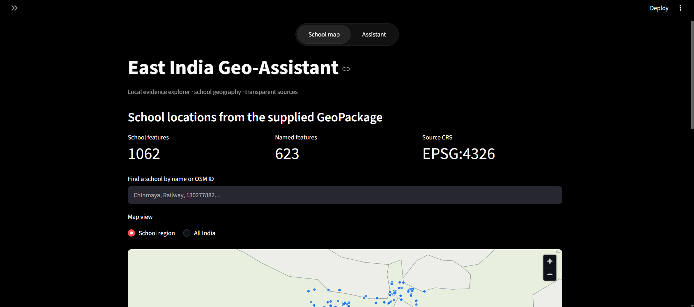
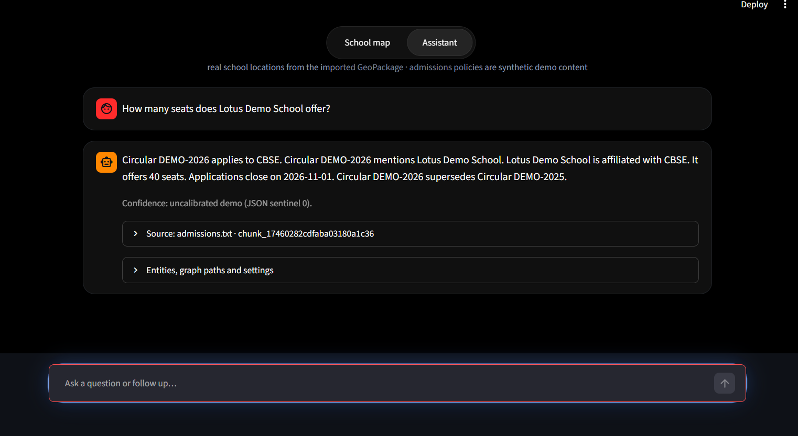

# East India Geo-Assistant

I built this project to explore school locations on a map and answer questions from a small, evidence-based demo corpus. The map uses the supplied `schools.gpkg` file. Admission notices and policies are synthetic examples, not real government rules.

## Screenshots

The map shows the school features from the GeoPackage. The assistant example uses a synthetic admission notice and displays its source.





## Run on Windows

I use Python 3.11 or newer. From the project folder, run:

```powershell
python -m venv .venv
.venv/Scripts/python.exe -m pip install -r requirements.txt
.venv/Scripts/python.exe -m pytest -q
.venv/Scripts/python.exe -m app.cli import-gpkg C:/path/to/schools.gpkg
.venv/Scripts/python.exe -m streamlit run app/ui.py --server.address 127.0.0.1 --browser.gatherUsageStats false
```

The GeoPackage is an input file and is not included in this repository. Import it before asking for locations from that data. Local model files and service credentials are also kept outside Git. See [`.env.example`](.env.example) for the names of optional settings, without secrets.

## What the data contains

The supplied GeoPackage has 1,062 school building polygons, 623 with names. It does not provide school boards, seat counts, cut-offs, roads, land use or admission policies. I use generated circulars and labels for the retrieval demo. Those records are marked synthetic in the project files and interface. A mapped point represents a position within a source polygon, not a verified entrance.

## Project files

- `app/`: Streamlit interface and question-answering pipeline
- `ingest/`: GeoPackage and text ingestion, chunking, extraction and relations
- `retrieve/`: search, fusion, reranking, confidence and abstention
- `evalsuite/`: metrics, questions and evaluation scripts
- `es/`, `geoserver/`: service configuration notes and mappings
- `evidence/`: assessment results and the screenshots above
- `diagram/`: system architecture diagram
- `PROJECT DOCUMENT.md`: setup, methods, results and limitations
- `docs/TRACEABILITY.md`: links from assessment requirements to project files

I generated the demo data and wrote the project with help from open-source packages and AI coding assistance. I reviewed the submission and remain responsible for explaining it. The project document lists the models, libraries and data limitations.
